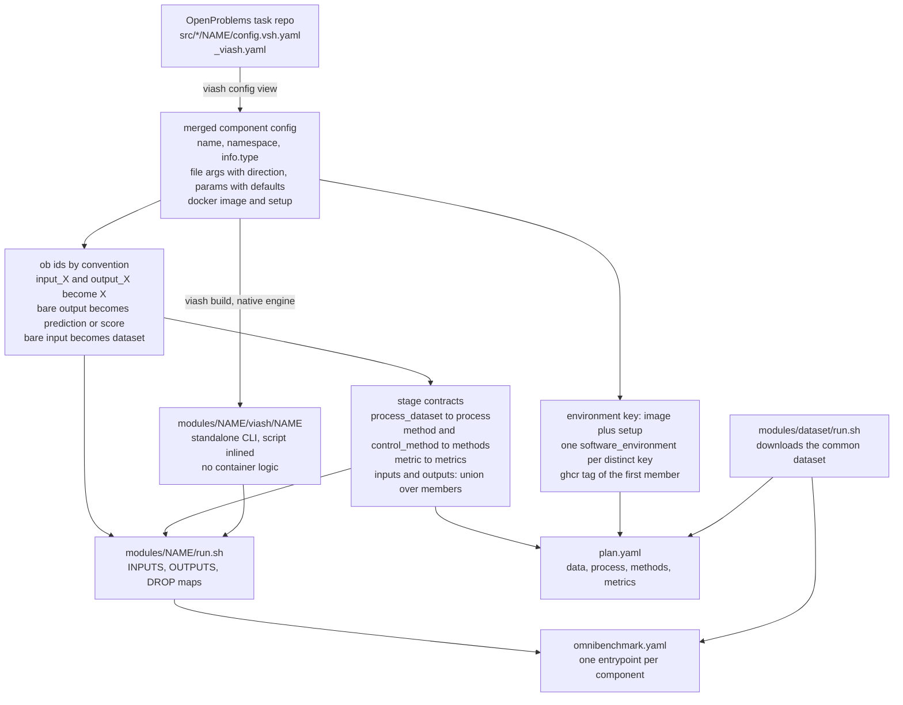
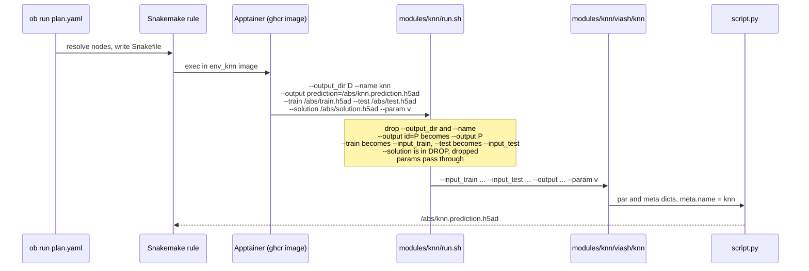

# How this plan is built and run

This repo turns an OpenProblems task (a set of [Viash](https://viash.io)
components) into an Omnibenchmark plan without changing the components.
`tools/viash2ob.py` does the generation; at run time ob, Snakemake and
Apptainer do the rest. Design rationale lives in omnibenchmark's
`docs/design/013-viash-adaptor.md`; this file is the mechanics.

## Generation

```
tools/viash2ob.py <task_dir> --dataset NAME=URL [--include a,b] [--exclude c]
```



Per component the generator:

1. Reads the merged config with `viash config view`. Viash resolves the
   `__merge__: /src/api/comp_*.yaml` references against the package root, so it
   runs from the directory holding `_viash.yaml`. (viash 0.9.7 exits 1 here
   even on success; the JSON on stdout is what counts.)
2. Derives ob ids from argument names: `--input_train` → `train`,
   `--output_solution` → `solution`, a bare `--output` → `prediction` for
   methods and `score` for metrics, a bare `--input` → `dataset`. These ids are
   the plan's stage inputs/outputs and therefore the `--<id>` flags ob passes.
3. Builds the component with the **native** engine. The published Docker image
   is recorded separately and becomes the module's `software_environment`;
   isolation is ob's job (Apptainer here), not the executable's.
4. Writes `run.sh`, the argv adaptor (next section). `DROP` holds the stage
   inputs this component does not declare: control methods take
   `input_solution`, plain methods do not, and they share one `methods` stage.
5. Collects non-file arguments with defaults as the module's parameters. Viash
   stores every default as a list; a `multiple` argument takes all values in
   one flag joined by `multiple_sep` (`100;100`), anything else is unwrapped
   to a scalar, because ob reads a YAML list as a parameter grid.

Then it writes `omnibenchmark.yaml` (one repo, one entrypoint per component),
and `plan.yaml`: a hand-written `data` stage (a loader module that downloads
the common dataset from S3), followed by `process`, `methods`, `metrics` with
their derived contracts, output paths `{module.id}.<id>.h5ad`, and the
deduplicated environments. Modules reference the repo itself
(`url: .`, `commit: HEAD`), which is why `ob run` needs `--dirty`.

## Run time



The shell line ob generates is the same as for any ob module; `run.sh` is
the only Viash-specific piece and it is 25 lines of bash:

| ob argv | component argv |
|---|---|
| `--output <id>=<path>` | `--<OUTPUTS[id]> <path>` |
| `--<id> <path>`, id in `INPUTS` | `--<INPUTS[id]> <path>` |
| `--<id> <path>`, id in `DROP` | dropped |
| `--output_dir`, `--name` | dropped |
| anything else (`--param value`) | unchanged |

Inside the image the native executable runs `python script.py` (or `Rscript`)
with Viash's `par`/`meta` dicts filled from argv, so `meta.name` is the
component name and ends up as `method_id` in the output `uns`, exactly as
under Nextflow.

## Environments

Components that declare the same `(image, setup)` share one environment,
referenced by the first member's ghcr tag, e.g. `env_logistic_regression`
serves logistic_regression, mlp, naive_bayes, accuracy and f1. This keeps the
SIF count (about 640 MB each) at six for twelve components. Snakemake pulls
`docker://` references into `out/.snakemake/singularity/` as SIFs; ob's
`docker` backend uses the same path, since Snakemake 9 only runs containers
through Apptainer.

## What is not generated

- `info.variants` parameter sets (each would be a row in `parameters:`).
- Resources: Nextflow labels (`midmem`, `midcpu`) map to numbers in
  `_viash.yaml` `config_mods`; not forwarded to `resources:` or Viash's
  `---cpus/---memory`.
- Normalization gating: methods declare `preferred_normalization`, datasets
  carry `normalization_id`; OP's workflow filters on it. The test dataset is
  `log_cp10k`, which every method accepts, so nothing is lost here. On real
  datasets this is `provides`/`requires` once ob has it, or `exclude` lists.
- A `scores` gather stage producing OP's `score_uns.yaml`.
- R and GPU methods: excluded from `--include` for disk and hardware reasons,
  not for any mapping problem.
